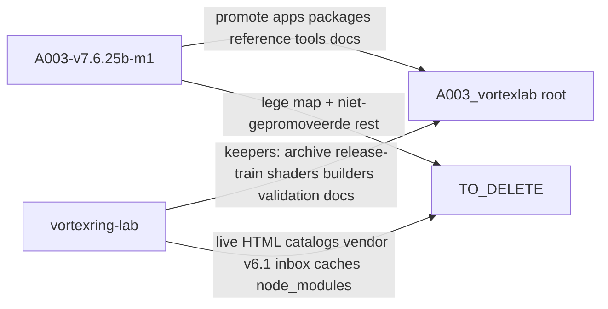

# A003 VortexLab root-consolidatie

## Uitgangspunt (gevalideerd)

- Actieve lab: [`A003-v7.6.25b-m1`](05_apps/A003_vortexlab/A003-v7.6.25b-m1) — `npm`-checks + `verify-parity` PASS vóór deze reorganisatie.
- Legacy parallel: [`vortexring-lab`](05_apps/A003_vortexlab/vortexring-lab) — bevat unieke keepers (archief, builders, shaders) én een tweede “actieve” lab-versie die verwarring veroorzaakt.
- Verwijderen = verplaatsen naar [`05_apps/A003_vortexlab/TO_DELETE/`](05_apps/A003_vortexlab/TO_DELETE/), niet permanent wissen.

## Doelstructuur

```text
05_apps/A003_vortexlab/
  FAMILY.yaml                 # bijgewerkt (flat layout)
  package.json, project.json, README.md, .gitignore
  apps/  packages/  reference/  tools/   # uit M1
  docs/                                  # M1 + gemergede vortexring-lab docs
  archive/
    pre-v7.6/                            # was vortexring-lab/archive/
    v7.6-release-train/                  # was vortexring-lab-v7.6-release-train/
    snapshots/A003-v7.6.25b-m1.zip       # M1 zip
  shaders/                               # uit vortexring-lab
  validation/                            # uit vortexring-lab
  tools/
    serve.mjs, verify-*.mjs, test-*.mjs  # M1
    catalog/                             # build_*.py, extract_core.py, patch-scripts + tests
  TO_DELETE/
    README.md
    vortexring-lab/                      # rest: live monolith-duplicaat, v6.1-track, inbox, caches, …
    A003-v7.6.25b-m1/                    # lege schil na promote
```



## Keep vs TO_DELETE (concrete keuze)

**Naar root (behouden):**
- Volledige M1-inhoud (apps, packages, reference, tools, docs, manifests).
- Uit `vortexring-lab`: `archive/`, `vortexring-lab-v7.6-release-train/`, `shaders/`, `validation/`, `build_twist_knot_data.py`, `build_knotplot_knots_data.py`, `extract_core.py`, `_patch_borromean_ui.py`, `tests/test_build_twist_knot_data.py`, relevante `docs/` (planning/patches/releases + KnotPlot/Twist READMEs).

**Naar `TO_DELETE/` (verwarring / duplicaat / regenerable):**
- “Actieve” parallelle lab-versie: root-`vortexring-lab-v7.6.25b.html`, catalog-JS-duplicaten (~101 MB al in `apps/web/data/`), `vendor/`, `package.json` van vortexring-lab.
- v6.1-refactorspoor: `vortexring-lab-v6.1.html`, `app/`, `physics/`, `diagnostics/`, `regression.cjs`, `tests/vortexlab-regression.mjs`.
- `inbox_from_to_be_processed/`, `node_modules/`, alle `__pycache__` / `.pytest_cache`.
- Lege/shell-mappen `A003-v7.6.25b-m1` en `vortexring-lab` na de moves.

`TO_DELETE/README.md` vermeldt: review → daarna handmatig wissen; niet committen van caches/`node_modules` indien mogelijk.

## Registry / FAMILY (verplicht)

Flat root betekent volgens [`catalog_metadata.py`](07_scripts/catalog_metadata.py) geen versioned child → zelfde patroon als A001/A002:

- [`FAMILY.yaml`](05_apps/A003_vortexlab/FAMILY.yaml): `unversioned: true`, `versions: []`, `layout` met o.a. `apps`, `archive`, `docs`, `packages`, `reference`, `shaders`, `tools`, `validation` (niet `TO_DELETE` in layout als we die als non-layout behandelen — expliciet weglaten of in NON_VERSION-documentatie; layout-lijst zonder `TO_DELETE`).
- Wetenschappelijke versie blijft in [`project.json`](05_apps/A003_vortexlab/A003-v7.6.25b-m1/project.json) (`v7.6.25b-m1`) + README.
- Update canonieke indices:
  - [`10_docs/registry/catalog_index.json`](10_docs/registry/catalog_index.json) — A003 `versions: []`, path blijft `05_apps/A003_vortexlab`.
  - [`10_docs/registry/family_hierarchy.json`](10_docs/registry/family_hierarchy.json) — geen `A003-v7.6.25b-m1` subdirectory; `other_dirs` zonder `vortexring-lab`.
- Padfixes in docs/builders:
  - Twist/KnotPlot READMEs: output → `apps/web/data/…` (niet meer `..\A003-v7.6.25b-m1\…`).
  - Root README: starten vanuit `A003_vortexlab` (`npm start` → `:4173`).
- Lichte check op [`07_scripts/_fix_collapsed_splits.py`](07_scripts/_fix_collapsed_splits.py) / catalog-tests: pad `05_apps/A003_vortexlab` blijft; subdirectory-asserts bijwerken.

Geen migratie-CSV-massaherschrijf tenzij een gate faalt; intermediate_paths naar oude A002-locaties blijven historische remaps.

## Uitvoervolgorde

1. Aanmaken `TO_DELETE/` + korte README.
2. M1-inhoud omhoog verplaatsen naar `A003_vortexlab/` (Move-Item; geen copy van 87 MB twist-data).
3. Keepers uit `vortexring-lab` verplaatsen/mergen (`archive/`, release-train, `shaders/`, builders → `tools/catalog/`, `validation/`, docs-merge).
4. Rest van `vortexring-lab` + lege M1-map → `TO_DELETE/`.
5. `FAMILY.yaml` + registries + README/builder-paden bijwerken.
6. Validatie:
   - `npm run check` vanuit nieuwe root
   - `python -m pytest tools/catalog/tests` (of equivalent pad) voor twist-builder
   - `pytest 07_scripts/test_catalog_registry.py` / relevante A003 asserts
7. Planbestand opslaan onder [`.cursor/plans/`](.cursor/plans/) (Workbench).

## Niet in scope

- Permanent wissen van `TO_DELETE/`
- Wetenschappelijke runtime-/formulewijzigingen
- M2-split van `vortexlab-runtime.js`
