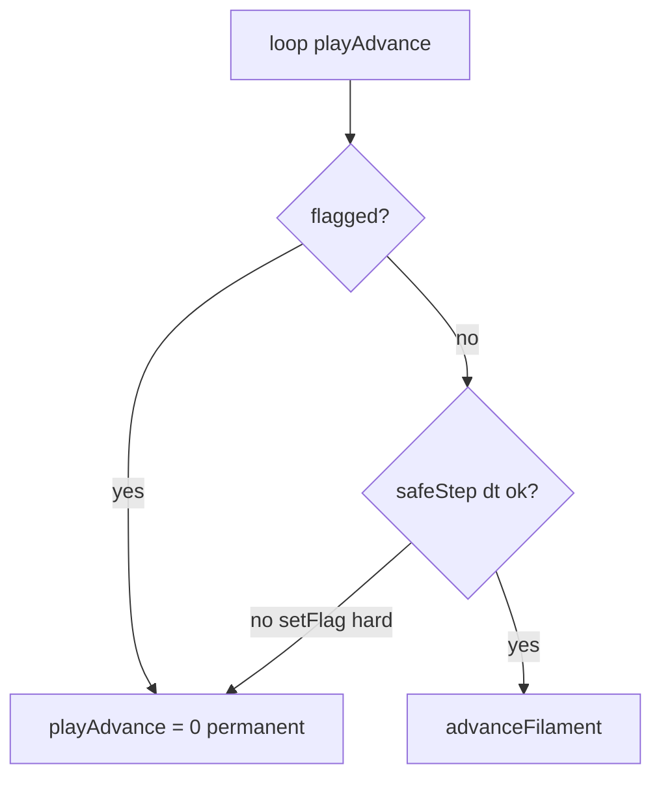

# VortexLab: beweging + catalogus-draaien herstellen

## Diagnose

### Lab: geen vortexbeweging

Bevestigd door [Investigate lab freeze](d54624ce-068c-4117-9318-df1d9c831f75): RAF blijft lopen; integratie sterft via `flagged`/`paused`. VL08 `radiusDrive` en research-track load order zijn **niet** de blocker.

**A. Permanente hard-stop via `flagged` (P2 t.o.v. oude silent clamp)**

In [`vortexlab-runtime.js`](05_apps/A003_vortexlab/apps/web/src/legacy/vortexlab-runtime.js) (rond 7887–7968):

- `playAdvance = (paused || flagged) ? 0 : …` — hard `flagged` ⇒ geen advance, wel render.
- P2 `safeStep`: `dt < 1e-6` → `setFlag` zonder `warnOnly`. Reference deed nog `return Math.max(1e-6, dt)` (~4983 in [`vortexring-lab-v7.6.25b.html`](05_apps/A003_vortexlab/reference/vortexring-lab-v7.6.25b.html)); huidige `dtCFL` retourneert raw `dt` (~3474–3477). Bevestigd o.a. door [Diagnose freeze+catalog](d13ebf4b-96cb-41f2-951b-a9e4b9394357).
- Trip-triggers: fine mesh + grote Γ; topology-CFL bij kleine margin / hoge `lastUmax` (~3469–3473); opnieuw na stap (~7965–7968). Default SST LIA blijft meestal boven 1 µs.
- Optionele-kettingbug: ontbrekende FQ ⇒ `!?.allFinitePositions(Y)` ⇒ altijd hard stop na eerste stap (~7915, ~7934).
- `runtimeFailure` (~7222–7229): elke `error`/`unhandledrejection` → hard flag; RAF is al opnieuw gepland dus UI blijft “levend”.

**B. Visuele false negative (geen banner)**

Default SST + `centerLock` + `displayFrame:'corot'` + kleine Γ: COM-rotatie weggefilterd; vormverandering kan “dood” lijken terwijl `t` nog kruipt. Fix: startup `displayFrame='lab'` (solverFrame blijft `corot`).

### Catalogus: knopen niet meer draaien

Bevestigd door [Investigate catalog rotate](a7a627f8-e332-4946-ac4e-e9002c08e218): **regressie van live drag-orbit**, niet CSS/`OrbitControls`.

- Huidige [`catalog-viewer.js`](05_apps/A003_vortexlab/apps/web/src/catalog-viewer.js): shared offscreen WebGL → `toDataURL` → 2D `cat-thumb`; vaste `camTh`/`camPh`; geen pointer-handlers.
- Eerdere `MAX_LIVE`-viewer had per-kaart WebGL + `pointerdown`/`pointermove` (`camTh += dx*0.01`). Snapshot-rewrite ruilde dat in tegen scroll-stabiliteit.
- `catalog.html` laadt alleen `catalog.css` (geen `vortexlab.css`); `powerPreference` is irrelevant.

Lab-camera op `#c3d` (~5389) bestaat nog. Als “draaien” in het **lab** faalt: hit-steal door dual-UI overlays ([Diagnose freeze+catalog](d13ebf4b-96cb-41f2-951b-a9e4b9394357)) — `.vl-sim-bottom-overlays` op `z-index:940!important`, undocked widgets `z-index:10010`, open docks/`localStorage` panes, en `.vl-pane-resizer` met `pointer-events:auto` onder gesloten panes. `#c3d` / `.vl-ui-shell` pass-through is correct.



## Gekozen aanpak

### 1. Lab-stepper: P2 behouden, geen permanente freeze

In [`vortexlab-runtime.js`](05_apps/A003_vortexlab/apps/web/src/legacy/vortexlab-runtime.js):

- **safeStep-fail**: `setFlag(msg, true)` (warnOnly) + `stepDebt = 0` + deze frame geen advance; **niet** `flagged` zetten. Geen kunstmatige dt-vergroting (P2-intent blijft).
- **allFinitePositions**: alleen falen als API bestaat én `false` teruggeeft, bv.  
  `const posOk = !window.VortexLabFluidQualification || window.VortexLabFluidQualification.allFinitePositions(Y);`
- **runtimeFailure**: warnOnly i.p.v. hard flag (log blijft; sim loopt door). Contact/RK4 non-finite mogen hard blijven waar fysisch terecht.
- **Startup-zichtbaarheid**: na `applySSTSimilarityPreset` in `applyDefaultStartup` expliciet `P.displayFrame = 'lab'` (solverFrame blijft `corot`), zodat Ω-gedreven rotatie weer zichtbaar is.

### 2. Catalogus: drag-orbit op thumbnails (shared renderer behouden)

Geen terugkeer naar `MAX_LIVE` live-contexten (flicker). In [`catalog-viewer.js`](05_apps/A003_vortexlab/apps/web/src/catalog-viewer.js) + [`catalog.css`](05_apps/A003_vortexlab/apps/web/styles/catalog.css):

- Parameteriseer `renderSnapshot(row, camTh, camPh)` (defaults 0.55 / 1.05).
- Per card `WeakMap`/`data-*` voor hoeken; pointer-drag met `dx*0.01` / `dy*0.01` (zoals voorheen).
- Op move: invalidate cache-key → `paintCard(card, renderSnapshot(...))` via shared WebGL.
- CSS: `touch-action: none; cursor: grab` op `.cat-thumb`; “Selecteer in lab” buiten drag-capture.

### 3. Lab hit-testing (camera-orbit)

In [`vortexlab.css`](05_apps/A003_vortexlab/apps/web/styles/vortexlab.css):

```css
.vl-pane:not(.vl-pane-open) .vl-pane-resizer { pointer-events: none; }
.vl-sim-bottom-overlays { pointer-events: none; } /* container blijft none */
.vl-bottom-widget { pointer-events: none; }
.vl-bottom-widget > summary,
.vl-bottom-widget[open] > .vl-overlay-surface { pointer-events: auto; }
```

Doel: lege overlay-ruimte en ingeklapte widgets laten `#c3d` door; summary/controls blijven bedienbaar. Geen wijziging aan `#c3d` / shell.

### 4. Tests + validatie

- Unit/smoke: bestaande fluid-qualification / runtime checks uitbreiden — default-achtige `dt` blijft `safeStep.ok`; gate-pad zet geen permanente `flagged` (of pure helper-test op de nieuwe guard-logica).
- Catalog: kleine test of helper dat angle-override de camera-positie wijzigt (pure functie uit viewer trekken als nodig).
- Voor start én na afloop: `npm run check` in `05_apps/A003_vortexlab`.
- Planbestand bewaren onder [`.cursor/plans/`](.cursor/plans/) (Workbench).

## Bestanden

| Bestand | Wijziging |
|---------|-----------|
| `apps/web/src/legacy/vortexlab-runtime.js` | soft safeStep, posOk-guard, runtimeFailure warnOnly, default displayFrame lab |
| `apps/web/src/catalog-viewer.js` | drag-orbit + angled re-render |
| `apps/web/styles/catalog.css` | touch-action / cursor |
| `apps/web/styles/vortexlab.css` | resizer + bottom-widget hit-through |
| tests onder `tools/` of bestaande check-suite | regressie voor gate + catalog angles |
| `.cursor/plans/vortexlab_motion_catalog_fix_*.plan.md` | dit plan |