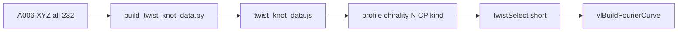

# Twist knot data library + filtered UI

## Beslissingen (vastgelegd)

- **Ingest:** alle 232 `.xyz` in [`02_libraries/.../Output/v050/geometry`](02_libraries/A_knot_libraries/A006_RoundFolded_Twist_Knot_Family/A006-v0.5.0/Output/v050/geometry).
- **Catalog-ID = volledige stem** (geen collapse).
- **Output:** [`twist_knot_data.js`](05_apps/A003_vortexlab/vortexring-lab/twist_knot_data.js) met `TWIST_KNOT_IDS` / `TWIST_KNOT_DB`.
- **UI:** tipbestand [`vortexring-lab-v7.6.25b.html`](05_apps/A003_vortexlab/vortexring-lab/vortexring-lab-v7.6.25b.html) met **filterbalk** zodat `#twistSelect` alleen matching entries toont.

## A006 naamgeving (parser-input)

| Soort | Voorbeeld | Velden |
|-------|-----------|--------|
| Classic knot | `KNOT_3_1_N1024_ORIG` | kind=KNOT, topology=`3_1`, profile=`null`, N=1024, chirality=ORIG, cp=`null` |
| Knot 11a | `KNOT_11a247_N0512_MIRROR` | idem |
| Link | `LINK_5_5_6_BALANCED_N1024_ORIG_CPFIXED61` | kind=LINK, topology=`5_5_6`, profile=BALANCED\|SOFT\|FLAT\|TIGHT, N, chirality, cp=CPFIXED61\|CPCENTER |

Counts in geometry: 104 KNOT (geen profile), 128 LINK (32× FLAT/SOFT/BALANCED/TIGHT; 64 CPCENTER + 64 CPFIXED61).

## Converter

Nieuw [`build_twist_knot_data.py`](05_apps/A003_vortexlab/vortexring-lab/build_twist_knot_data.py) o.b.v. [`build_knotplot_knots_data.py`](05_apps/A003_vortexlab/vortexring-lab/build_knotplot_knots_data.py):

- Hergebruik XYZ→DFT, linking, diagnostics, JS emit.
- A006-parser schrijft per entry filtervelden: `kind`, `topology`, `profile`, `resolutionN`, `chirality`, `cpMode`.
- Sidecar `.json` → `status` / `sourceSha256` / warnings.
- Emit compact JS (`--compact` default).

## Entry-schema (extra filtervelden)

Fourier-contract ongewijzigd (`components[].coeffs[{I,A,B}]`), plus:

- `source: "a006-roundfolded-twist"`, `ideal: false`
- `kind`, `topology`, `profile` (`null` voor KNOT), `resolutionN`, `chirality`, `cpMode` (`null` voor KNOT)
- `family`, `L`, `pairwiseLinking`, `diagnostics`

## UI: filterbalk + korte lijst

Naast Ideal/Fseries/KnotPlot een twist-sectie:

1. Script-tag: `twist_knot_data.js`
2. Filters (aparte `<select>`s):
   - **Kind:** All / Knot / Link — default **Knot**
   - **Profile:** All / FLAT / SOFT / BALANCED / TIGHT — default **BALANCED** (alleen van toepassing op LINK; KNOT-entries negeren dit filter wanneer Kind=Knot/All)
   - **Chirality:** Original / Mirrored — default **Original** (`ORIG`)
   - **N:** 256 / 512 / 1024 / 2048 — default **1024**
   - **CP (links):** All / CPFIXED61 / CPCENTER — default **CPFIXED61** (alleen LINK; voorkomt dubbele entries)
3. `#twistSelect` wordt **herberekend** bij elke filterwijziging: alleen IDs waarvan DB-metadata matcht; labels tonen korte naam (`3_1`, `5_5_6`, …) i.p.v. de volledige stem.
4. Met defaults (Knot + ORIG + N1024) ≈ **13** opties; Link + BALANCED + ORIG + N1024 + CPFIXED61 ≈ **2** opties — i.p.v. 232.
5. Catalog accessors + mutually exclusive bronkeuze (`source:'twist'`).
6. Holdout-checkbox `cSpecHoldoutTwist` zonder de vaste SpecClock-topology-matrix met 232 IDs te vullen.
7. Changelogregel in v7.6.25b.

## Docs + tests

- README: scan-commando, ID-conventie, **filterdefaults**, betekenis profile/CP.
- Tests: parser op KNOT- en LINK-stems; filter-predicate (JS of gedeelde pure helper in HTML-test/smoke); dry-run count 232; generate smoke.

## Scope-grenzen

- Geen wijziging Ideal/Fseries/KnotPlot-data.
- Geen Ridgerunner/release-train kopie tenzij later gevraagd.
- Catalogus blijft volledig (232); filters verkorten alleen de UI-lijst, niet de gegenereerde DB.
