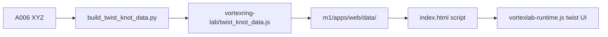

# Twist catalog: KnotPlot-achtig formaat + m1 deploy

## Probleem

Huidige [`twist_knot_data.js`](05_apps/A003_vortexlab/vortexring-lab/twist_knot_data.js) is een compacte one-liner (~37 MB) en lijkt niet op [`knotplot_knots_data.js`](05_apps/A003_vortexlab/vortexring-lab/knotplot_knots_data.js). De modular app [`A003-v7.6.25b-m1`](05_apps/A003_vortexlab/A003-v7.6.25b-m1) laadt catalogs uit [`apps/web/data`](05_apps/A003_vortexlab/A003-v7.6.25b-m1/apps/web/data) via [`index.html`](05_apps/A003_vortexlab/A003-v7.6.25b-m1/apps/web/index.html) en mist nog twist.

## Beslissing

- **Nu (stap 3):** formaat/schema alignen met KnotPlot-build; alle 232 native N-varianten behouden (geen N300/D=1).
- **Deploy:** dezelfde JS ook naar m1 `apps/web/data`, index + runtime aanpassen.
- **Later:** aparte N=1024-only `.js` (niet in deze tranche).

## 1. Builder + regeneratie (vortexring-lab)

Spiegel emit van [`build_knotplot_knots_data.py`](05_apps/A003_vortexlab/vortexring-lab/build_knotplot_knots_data.py) in [`build_twist_knot_data.py`](05_apps/A003_vortexlab/vortexring-lab/build_twist_knot_data.py):

- Pretty-print default (`indent=2`; compact opt-in).
- Entry dichter bij KnotPlot: `sourceRole` (`a006-native-N{N}`), volzin-`source`, `normalization` shape; `D` blijft `null`.
- Filtervelden blijven: `kind`, `topology`, `profile`, `resolutionN`, `chirality`, `cpMode`.
- `--fresh` regenerate → 232 entries.

Monolith [`vortexring-lab-v7.6.25b.html`](05_apps/A003_vortexlab/vortexring-lab/vortexring-lab-v7.6.25b.html) blijft de al aanwezige twist-filters gebruiken (geen N-filter verwijderen).

## 2. m1 data + index

Na regeneratie:

1. Kopieer `twist_knot_data.js` → [`A003-v7.6.25b-m1/apps/web/data/twist_knot_data.js`](05_apps/A003_vortexlab/A003-v7.6.25b-m1/apps/web/data/twist_knot_data.js) (naast ideal/fourier/knotplot).
2. In [`index.html`](05_apps/A003_vortexlab/A003-v7.6.25b-m1/apps/web/index.html) na de knotplot-scriptregel:

```html
<script src="./data/twist_knot_data.js" onerror="void 0"></script>
```

3. Voeg de twist filter-rij + `#twistSelect` toe in de knoop-controls (nu stopt de markup bij `#knotplotRow`).

## 3. m1 runtime wiring

[`vortexlab-runtime.js`](05_apps/A003_vortexlab/A003-v7.6.25b-m1/apps/web/src/legacy/vortexlab-runtime.js) heeft nog geen twist-catalogus. Port vanuit de monolith:

- `getTwistKnotCatalog`, `twistEntryMatchesFilters`, `readTwistFilterState`, `populateTwistSelect`, `resolveTwistHoldoutKey`
- `knotCatalogForSource('twist')`, `applyCatalogSelection` / `syncKnotSel` / `initKnots`
- optionele holdout-checkbox `cSpecHoldoutTwist` (zelfde gedrag als monolith)

Zonder deze runtime-stap doet alleen de script-tag niets bruikbaars.



## Explicit out of scope

- Arc-length resample N=300 / D=1
- Nieuwe N=1024-only library-file

## Validatie

- Pretty IDS-array + indented entries; 232 IDs.
- m1 `data/twist_knot_data.js` aanwezig; `index.html` laadt `./data/twist_knot_data.js`.
- Runtime: `getTwistKnotCatalog()` non-null na load; default filters → korte `#twistSelect`.
- Unit tests + README (pretty default, m1 pad, N1024 later).
