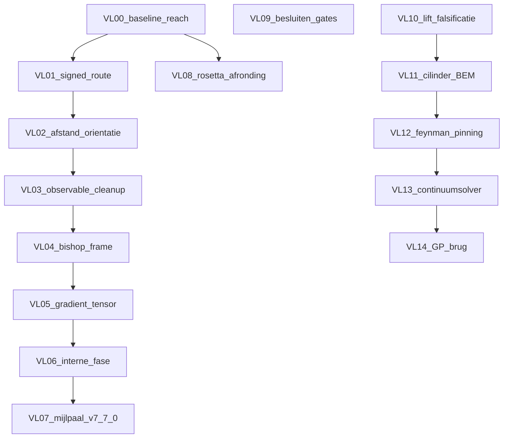

# VortexLab v7.x EPIC

Status: `OPEN` · Baseline runtime: `7.6.25b-m1-fluidqual-p2` · App-root: [`05_apps/A003_vortexlab/`](../../05_apps/A003_vortexlab/)

Index van open taken: [VL00](../not_done/VL00_baseline_reach.plan.md) … [VL14](../almost_complete/VL14_GP_reconnectiebrug.plan.md).

Dit epic vervangt de zes voormalige planningdocumenten in `docs/planning/` (verwijderd bij aanmaak van deze map).

## 1. Baseline-testresultaat (documentatie-tranche)

Uitgevoerd bij epic-aanmaak in `05_apps/A003_vortexlab`:

```text
npm run check → PASS
  native-resolution / tracer-budget: 20 PASS
  runtime native-N: 7 PASS
  xyz-import: PASS
  catalog-geometry: PASS
  fluid P2: 19 PASS
  verify-parity: PASS (runtime + catalogs + vendor)
```

Geen browser-`?selftest=1` en geen interactieve reach-run in deze tranche (zie VL00).

## 2. Done-log (niet opnieuw plannen)

| Item | Versie | Bewijs |
|------|--------|--------|
| B1–B8, v7.1.1-rest, exacte afstanden/bisectie, Wr/Lk/ACN, T1–T6 | v7.1–v7.2 | stappenplan v4/v5 §0 (historisch) |
| Dock, kernstraal, ModelLog, aPhys-kiem, v7.3.1-hotfix | v7.2.1–v7.3.1 | `docs/releases/release-notes-v7.3.1.md` |
| Positionering klein (Ŝ, Rankine-label, χ_Ω/Ro/a/R, GP-Δ-keuze, Γ-teken) | v7.4a | `docs/releases/release-notes-v7.4.md` |
| Auditcorrectie provenance/HUD/capaciteit/T0e–h | v7.4.1 | `docs/patches/CURSOR-patch-instructies-v7.4.1.md` |
| Merge bundel-r1 + exclusiviteit + T9a–e | v7.4.2 | `docs/releases/release-notes-v7.4.2.md` |
| Frame-ontvlechting, T8 E_frame=6.6e-8, ε_rev, g_a, T1b | v7.5 (=v7.4b-scope) | `docs/releases/release-notes-v7_5.md` |
| `coreFlowLock` default false | v7.5 / T0i | runtime `coreFlowLock:false` |
| R_horn / r_kern / a_sim + gedeeld backgroundVelocityAt | v7.5.1 | `docs/releases/release-notes-v7_5_1.md` |
| Topology guard + knooptube Neumann-BEM/MFS | v7.5.2 | `docs/patches/v7_5_2-package/release-notes-v7_5_2.md` |
| g_a exact, passieve a_probe / String-preset, T11–T13 | v7.5.4 | `docs/releases/release-notes-v7_5_4.md` |
| Speculative swirl-clock A↔B + afstandsbediening | v7.6.5–v7.6.10 | release-train CHANGELOG |
| Fase-null, integratorbootstrap, 10-run benchmark | v7.6.11–v7.6.15 | archive release-notities |
| Proxy-decompositie D0–D5 + Shapley | v7.6.16 | schema `/1.0` → later `/2.x` |
| Normalisatie, transfer-law, v↺*, lengte-routes, κ_geom | v7.6.17–v7.6.22 | archive changelogs |
| Gatecorrectie R6/R23/R27, continuum-audit, R15=scale-screen | v7.6.23 | `docs/releases/README-v7.6.23.md` |
| Intrinsieke Ω, embeddings, cross-knot holdouts | v7.6.24–v7.6.24f2 | archive changelogs |
| Continue DCSD/reach-solver G0–G5 | v7.6.25 / 25a / 25b | `docs/releases/vortexring-lab-v7.6.25b-changelog.md` |
| Fluid-P2 numerieke veiligheid (geen Euler-sluiting) | m1-fluidqual-p2 | `docs/patches/A003_Fluid_Qualification_P2_README.md` |

## 3. Open werk — subplannen



| Subplan | Rol | Status bij epic-start |
|---------|-----|------------------------|
| [VL00](../not_done/VL00_baseline_reach.plan.md) | Reach-acceptatie + versiestring + browser-zelftest | open (code aanwezig, runs incompleet) |
| [VL01](../not_done/VL01_signed_swirl_clock.plan.md) | v7.6.26 signed lokale route | open |
| [VL02](../not_done/VL02_afstand_orientatie_multipool.plan.md) | v7.6.27 afstand/oriëntatie/multipool | open |
| [VL03](../not_done/VL03_observable_separation.plan.md) | v7.6.28 hernoemingen + UI-blokken | open |
| [VL04](../not_done/VL04_bishop_material_frame.plan.md) | v7.6.29 passief Bishop-frame | open |
| [VL05](../not_done/VL05_velocity_gradient_tensor.plan.md) | v7.6.30 G/S/W | open |
| [VL06](../not_done/VL06_interne_fase_kandidaten.plan.md) | v7.6.31 afgeleide fasekandidaten | open |
| [VL07](../not_done/VL07_confirmatory_v7_7_0.plan.md) | v7.7.0 confirmatoire mijlpaal | open |
| [VL08](../not_done/VL08_rosetta_string_afronding.plan.md) | v7.6-S rest | deels (Planck/a_probe aanwezig) |
| [VL09](../almost_complete/VL09_besluiten_stewartson_xi.plan.md) | Stewartson + ξ↔r_kern | open (documentatie) |
| [VL10](../almost_complete/VL10_lift_falsificatie.plan.md) | Lift op bundel | open · ontwerpdoc eerst |
| [VL11](../almost_complete/VL11_cilinder_bem.plan.md) | Cilinder/caps u·n=0 | deels (tube-BEM bestaat) · ontwerpdoc eerst |
| [VL12](../almost_complete/VL12_feynman_pinning.plan.md) | Feynman-rooster + pinning | open · ontwerpdoc eerst |
| [VL13](../almost_complete/VL13_continuumsolver.plan.md) | Roterende continuum / Fluid-P3 | open · ontwerpdoc eerst |
| [VL14](../almost_complete/VL14_GP_reconnectiebrug.plan.md) | GP-reconnectiebrug | open · ontwerpdoc eerst |

## 4. Traceerbaarheid (origineel → subplan)

| Bron (verwijderd) | Open item | Subplan |
|-------------------|-----------|---------|
| stappenplan v4/v5 §1 | frame/ε_rev/g_a/T1-sweep | **DONE** v7.5 |
| stappenplan v4/v5 §2 | Stewartson · coreFlowLock | VL09 / **DONE** coreFlowLock |
| stappenplan v4/v5 §3 item 7 | continuumsolver | VL13 |
| stappenplan v4/v5 §3 item 8 | GP-brug | VL14 |
| stappenplan v4/v5 §3 item 9 | wandbeelden/BEM cilinder | VL11 |
| stappenplan v4/v5 §3 item 10 | Feynman + pinning | VL12 |
| stappenplan v4/v5 §3 item 11 | lift-falsificatie | VL10 |
| stappenplan v4/v5 §4 | S1-rest/S2/S3/radiusDrive/T7 | VL08 |
| stappenplan v4/v5 §5 | a↔ξ-gate | VL09 |
| stappenplan v6 §1–2 | merge + guards + T9 | **DONE** v7.4.2 |
| stappenplan v6 §3 | v7.4b verkleind | **DONE** v7.5 |
| stappenplan v6 §5 | v7.5.1–5 herordend | VL10–VL14 |
| proxy-decomp v7.6.16 | hele plan | **DONE** v7.6.16+ |
| analyse v7.6.22 §12 v7.6.23 | gatecorrectie | **DONE** v7.6.23 |
| analyse v7.6.22 §12 v7.6.24 | reach/DCSD | **DONE** v7.6.25 (acceptatie → VL00) |
| analyse / roadmap v7.6.25 | signed route | VL01 (nummering roadmap) |
| analyse / roadmap v7.6.26–30 | afstand…gradient | VL02–VL05 |
| analyse §v7.6.30 / roadmap v7.7.0 | fasekandidaten + mijlpaal | VL06–VL07 |

Nummeringsverschil: de analyse-v7.6.22 noemt continue reach als v7.6.24; de latere roadmap als v7.6.25. De code gebruikt v7.6.25. In-app roadmap (runtime) volgt VL01–VL07 als v7.6.26→v7.7.0.

## 5. Wetenschappelijke grenzen

- Research Track blijft passief tot een subplan expliciet solverkoppeling eist met aparte afleiding, ENGINE-gates en holdouts.
- Geen κ_geom-factor toevoegen uit post-hoc nabijheid (o.a. 1/(8π) uit v7.6.22).
- Speculatief, derived en orthodox blijven gescheiden (zie `AGENTS.md`).
- VL10–VL14 starten met een ontwerpdocument; code volgt pas na acceptatie van dat ontwerp.

## 6. Buiten scope

- M2-modularisatie van `vortexlab-runtime.js` ([ARCHITECTURE.md](../../05_apps/A003_vortexlab/docs/ARCHITECTURE.md)).
- Lopende consolidatie `a003_vortexlab_consolidate`.
- Productie-campagnes (volledige confirmatory suite) tenzij een subplan dat eist.

## 7. Epic done-criteria

- VL00–VL07: geïmplementeerd of bewust `SKIPPED` met reden in het subplan.
- VL08–VL09: afgerond of besluit vastgelegd.
- VL10–VL14: elk heeft een geaccepteerd ontwerpdoc; implementatie mag open blijven tot ontwerp ACK.
- Runtime-roadmap in CLOCK-paneel wijst naar deze epic-map of is synchroon met VL01–VL07.
